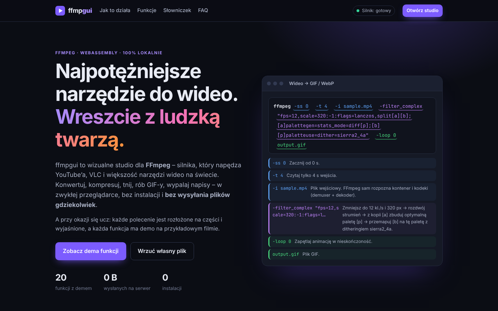
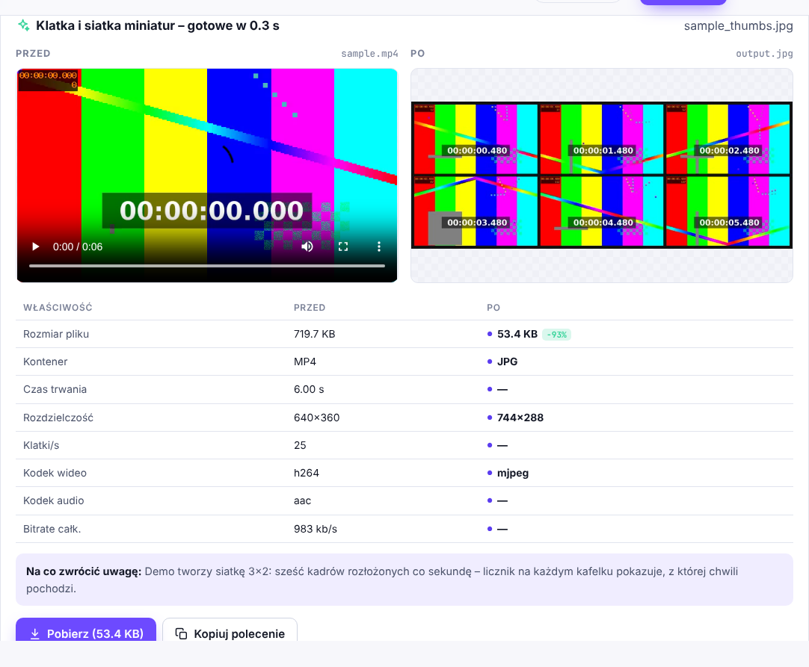

# ffmpgui — FFmpeg w przeglądarce, z ludzką twarzą

**ffmpgui** to wizualne studio dla [FFmpeg](https://ffmpeg.org) działające w całości w zwykłej przeglądarce.
Konwertujesz, kompresujesz, tniesz, robisz GIF-y, wypalasz napisy i dodajesz logo — **bez instalacji i bez wysyłania plików na serwer**.
A przy okazji uczysz się FFmpeg: każde polecenie jest pokolorowane i rozłożone na części z wyjaśnieniem, a każda funkcja ma **demo** na przykładowym filmie.



## Uruchomienie

To statyczna strona bez kroku budowania. Wystarczy dowolny serwer HTTP:

```bash
git clone https://github.com/imbirwmiodzie/ffmpgui.git
cd ffmpgui
python3 -m http.server 8000
# otwórz http://localhost:8000
```

Można ją też wrzucić na GitHub Pages, Netlify, Cloudflare Pages itp. (Settings → Pages → „Deploy from a branch”, katalog `/`).

> Otwarcie `index.html` bezpośrednio z dysku (`file://`) nie zadziała — przeglądarki blokują wtedy Web Workery z modułami ES.

Przy pierwszym użyciu przeglądarka pobiera rdzeń FFmpeg.wasm (~31 MB) z CDN (jsDelivr, zapasowo unpkg) i trzyma go w cache.

## Funkcje

Każda funkcja ma trzy warstwy: **„Co to robi”** (dla każdego), **„Jak to działa w FFmpeg”** (explainer techniczny) i **Demo**, które pokazuje wynik obok oryginału z tabelą zmian (rozmiar, kodeki, rozdzielczość, czas, bitrate).

| Grupa | Funkcja | Co robi | Kluczowe elementy FFmpeg |
|---|---|---|---|
| Podstawy | **Analiza pliku** | kontener, strumienie, kodeki, bitrate | `ffprobe -show_format -show_streams` |
| | **Konwersja formatu** | MP4 / WebM / MKV / MOV, opcjonalnie remux bez strat | `-c:v libx264`, `libvpx`, `libopus`, `-c copy` |
| | **Kompresja** | mniejszy plik przy kontrolowanej jakości | CRF, preset, H.264 / H.265 |
| | **Zmiana rozdzielczości** | 4K → 1080p → 720p…, algorytm skalowania | `scale=W:-2:flags=lanczos` |
| | **Przycinanie** | fragment od–do, precyzyjnie lub błyskawicznie | `-ss`, `-t`, klatki kluczowe |
| Obraz | **Kadrowanie** | 1:1, 9:16 (Reels/TikTok), 4:5, 21:9, własny | `crop=w:h:x:y` |
| | **Obrót i odbicie** | 90°, 180°, lustro | `transpose`, `hflip`, `vflip` |
| | **Korekcja kolorów i efekty** | jasność, kontrast, nasycenie, sepia, vintage, winieta… | `eq`, `colorchannelmixer`, `curves`, `vignette` |
| | **Tekst na wideo** | tytuł / podpis z pozycją, kolorem i czasem | `drawtext` + czcionka DejaVu |
| | **Wypalanie napisów (SRT)** | wklejasz SRT, dostajesz napisy w obrazie | `subtitles` (libass) |
| | **Znak wodny / logo** | logo PNG w rogu z przezroczystością | `-filter_complex`, `overlay`, `-map` |
| | **Ściemnianie** | fade in/out obrazu i dźwięku | `fade`, `afade` |
| Czas i ruch | **Zmiana prędkości** | ×0,25 … ×4, dźwięk bez „efektu Smerfa” | `setpts`, `atempo` |
| | **Odtwarzanie wstecz** | klip od końca | `reverse`, `areverse` |
| Dźwięk | **Wyodrębnij dźwięk** | MP3, M4A, Opus, FLAC, WAV + kształt fali | `-vn`, `libmp3lame`, `flac`… |
| | **Usuń dźwięk** | wyciszenie w sekundę, bez strat obrazu | `-an -c:v copy` |
| | **Głośność i normalizacja** | ±dB albo do −14/−16/−23 LUFS | `volume`, `loudnorm`, `dynaudnorm` |
| Eksport | **Wideo → GIF / WebP** | GIF z własną paletą kolorów | `palettegen` + `paletteuse` |
| | **Klatka i siatka miniatur** | thumbnail albo contact sheet | `-frames:v 1`, `tile` |
| Zaawansowane | **Własne polecenie** | dowolne argumenty jak w terminalu + przykłady | `hstack`, `xstack`, `gblur`, `showwaves` |



### Co jeszcze jest w środku

- **Explainer „Jak FFmpeg przetwarza plik?”** — interaktywny schemat demuxer → dekoder → filtry → enkoder → muxer, z przełącznikiem pokazującym ścieżkę `-c copy`.
- **Anatomia polecenia** — najedź na fragment polecenia, żeby zobaczyć, co robi; kolory odpowiadają etapom schematu.
- **Żywy podgląd polecenia** w studiu — zmieniasz parametr, polecenie i jego legenda aktualizują się od razu; przycisk kopiowania daje gotowe `ffmpeg …` do terminala.
- **Porównanie przed/po** — dwa odtwarzacze, „odtwórz oba od początku”, tabela zmienionych właściwości, wykres fali dla funkcji audio.
- **Łączenie operacji** — „Użyj wyniku jako wejścia” pozwala np. przyciąć → skadrować → zrobić GIF.
- **Plik przykładowy generowany przez sam FFmpeg** (`testsrc2` + licznik czasu `drawtext` + `sine`), więc demo działa bez pobierania żadnego wideo.
- Słowniczek (kontener, kodek, strumień, bitrate, CRF, preset, klatka kluczowa, filtr, stream copy, PTS) i FAQ z ograniczeniami.
- Ciemny i jasny motyw (wg ustawień systemu), układ responsywny do szerokości telefonu.

## Jak to działa

```
index.html          strona: hero, explainery, karty funkcji, studio, słowniczek, FAQ
css/style.css       wygląd (tokeny kolorów, ciemny/jasny motyw)
js/app.js           logika UI: formularze, podgląd polecenia, uruchamianie, wyniki
js/features.js      definicje funkcji: opisy, parametry, budowanie polecenia, preset demo
js/engine.js        cienka warstwa nad ffmpeg.wasm (ładowanie z CDN, kolejka, ffprobe)
js/icons.js         ikony SVG
vendor/             @ffmpeg/ffmpeg i @ffmpeg/util (ESM, MIT)
```

Każda funkcja w `js/features.js` zwraca polecenie jako listę **segmentów** — fragment argumentów + kategoria (wejście, filtr, enkoder wideo/audio, wyjście) + opis. Z tej samej struktury powstaje zarówno lista argumentów dla `ffmpeg.exec()`, jak i pokolorowane polecenie z legendą. Dodanie nowej funkcji to dopisanie jednego obiektu.

FFmpeg działa w Web Workerze (jednowątkowy rdzeń `@ffmpeg/core`, więc nie są potrzebne nagłówki COOP/COEP), a pliki trzyma w wirtualnym systemie plików w pamięci.

## Ograniczenia

- Limit pamięci WebAssembly to ok. 2 GB — wygodnie pracuje się z plikami do kilkuset MB.
- Wersja przeglądarkowa jest jednowątkowa i bez GPU: zwykle 5–20× wolniejsza niż natywny FFmpeg.
- Nie ma dostępu do kamer, mikrofonów ani strumieni sieciowych.

## Licencje

`@ffmpeg/ffmpeg` i `@ffmpeg/util` — MIT. Rdzeń `@ffmpeg/core` (pobierany z CDN) — GPL-2.0-or-later. Czcionka DejaVu (pobierana z CDN) — licencja Bitstream Vera / DejaVu.
FFmpeg jest znakiem towarowym Fabrice’a Bellarda.
